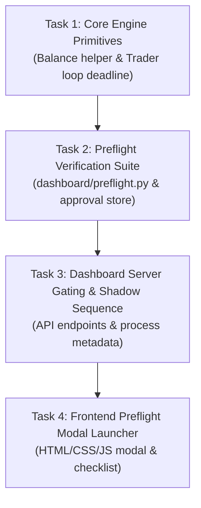

# Plan — Issue #857: Preflight-guided Start Run launcher with mode selection, 24h horizon, and watchdog

Branch: `i857/preflight-guided-start-run-launcher` | Issue: #857

Size: **Standard** — 1 new file (`dashboard/preflight.py`), surgical modifications across dashboard backend/frontend, trader loop, order manager, and tests; no database migration or new third-party dependencies.
Task type: **Code + Design/UI + Security + Testing**.

---

## 0. CodeRabbit Intake (read once, costed once)

- **Adopted:**
  - 4-step sequential preflight check: `credentials` -> `screener` -> `stream` -> `reach_probe`.
  - Gated single-use approval token (`preflight_id`) required by `POST /api/system/start`.
  - Absolute `--deadline-ts` epoch timestamp flag for `core_brain/trader_loop.py` using `make_deadline_sleep`.
  - Watchdog supervision via `order_manager poll --watch-guardrails` rather than spawning a duplicate dashboard process.
  - `#start-run-modal` replacing direct start request on `#btn-master-toggle`.
  - Fresh sequence database naming (`data/NN_shadow_<stamp>.db`) for Shadow runs.
- **Rejected:**
  - Writing an order-placing probe adapter (claimed `core_brain/reach_probe.py` was missing; live codebase inspection confirmed `core_brain/reach_probe.py` exists and is fully implemented).
  - Gating Decide service card behind preflight (typed `START` confirmation already protects Decide card).
  - Background dashboard timer process for deadline (process can restart; CLI flag `--deadline-ts` on trader loop is robust and autonomous).
- **[UNVERIFIED] Resolutions from Live Code:**
  - `core_brain/reach_probe.py` status: **RESOLVED**. Module is present (32.2KB), provides `reach_probe_cmd()` and `REACH_PROBE_MAX_EXPOSURE_USD`.
  - `poll` watchdog capability: **RESOLVED**. `core_brain/order_manager.py` already supports `--watch-guardrails` and supervises `scripts.global_stop_loss`.
  - `trader_loop` deadline handling: **RESOLVED**. `core_brain/trader_loop.py` lines 864-866 already catch `_Deadline` and exit cleanly; only the CLI argument and `make_deadline_sleep` wrapper need to be wired.
  - Numbered shadow database sequence: **RESOLVED**. `scripts/spread-hunter-menu.ps1` lines 451-471 define `Get-NextShadowSeq`; python implementation matches this exact logic.

---

## 1. Improvement Proposal (Grounded in Codebase Evidence)

- **Proposal:** Unified Watchdog Telemetry & Zero-Duplication Process Architecture.
- **Evidence:** `dashboard/server.py` lines 1258-1268 notes that `scripts.global_stop_loss` was omitted from `_start_stack_commands()`, yet `core_brain/order_manager.py` poll loop already supports `--watch-guardrails` which safely spawns and supervises `_spawn_global_stop_losser(db_p)`. Furthermore, `_guardrail_health()` is already written in `dashboard/server.py`.
- **Classification:** **Simplification & Edge-case Hardening (Adopt-by-default)**.
- **Action:** Instead of introducing a 4th daemon service in `dashboard/server.py` (which risks lock contention or duplicate alerts), pass `--watch-guardrails` to `order_manager poll` and wire its health directly into start responses and UI telemetry.

---

## 2. Interface Contracts

### 2.1 Balance Helper (`core_brain/order_manager.py`)
```python
def get_balance_allowance(funder: str | None = None, client_instance: Any = None) -> dict[str, Any]:
    """Return USDC collateral balance and allowance details.
    
    Returns:
        {
            "balance_usd": float,
            "allowance_usd": float,
            "allowances": dict[str, float] | None,
            "raw": dict[str, Any]
        }
    """
```

### 2.2 CLI Deadline Flag (`core_brain/trader_loop.py`)
```bash
python -m core_brain.trader_loop --live --deadline-ts <epoch_seconds>
```
Clamps rotations and exits cleanly with `shutdown_reason = "deadline"` upon reaching the horizon.

### 2.3 Preflight API (`POST /api/system/preflight`)
```json
// Request
{
  "step": "credentials" | "screener" | "stream" | "reach_probe",
  "preflight_id": "string (optional for first step)",
  "confirm": true // required only for reach_probe
}

// Response
{
  "ok": true,
  "step": "credentials",
  "summary": "Balance $150.00 USDC, allowance verified, 0 open orders",
  "details": { ... },
  "preflight_id": "uuid4_string",
  "next_step": "screener",
  "approved": false,
  "expires_in_sec": null
}
```

### 2.4 Gated Start API (`POST /api/system/start`)
```json
// Request
{
  "preflight_id": "uuid4_string",
  "minutes": 1440
}

// Response
{
  "ok": true,
  "message": "Stack started with 24h horizon",
  "run": {
    "run_id": "live-20261027-1440m",
    "minutes": 1440,
    "started_at": "2026-10-27T23:30:00Z",
    "deadline_at": "2026-10-28T23:30:00Z",
    "expired": false
  },
  "watchdog": { ... },
  "services": { ... }
}
```

---

## 3. Dependency Graph & Task Breakdown



### Task 1: Core Engine Primitives [Backend/Logic]
- **Size:** S (2 files modified)
- **Domain:** Backend / Logic
- **Files:** `core_brain/order_manager.py`, `core_brain/trader_loop.py`, `tests/test_order_manager.py`, `tests/test_trader_loop.py`
- **Depends on:** None
- **Description:**
  - Extract `get_balance_allowance(funder=None, client_instance=None)` in `core_brain/order_manager.py`; rewrite `balance()` to delegate to it without altering stdout.
  - Add `--deadline-ts` to `core_brain/trader_loop.py` argument parser. Wrap `sleep_fn` with `make_deadline_sleep()` from `core_brain/shadow_run.py`. If deadline is already past at launch, log and exit immediately.
- **Verification:**
  - `python -m pytest -q tests/test_order_manager.py tests/test_trader_loop.py`

### Task 2: Preflight Verification Suite & Approval Store [Backend/Security]
- **Size:** M (1 new file)
- **Domain:** Security / Core Logic
- **Files:** `dashboard/preflight.py`, `tests/test_dashboard_server.py`
- **Depends on:** Task 1
- **Description:**
  - Create `dashboard/preflight.py` containing:
    - `check_credentials()`: uses `get_balance_allowance`, validates funder/signer, checks minimum notional.
    - `check_screener()`: validates `runtime/markets.json` age <= 15 minutes via `load_graduated_snapshot()`.
    - `check_stream()`: runs fast REST full book and short-lived `MarketStream` connectivity probe.
    - `check_reach_probe(confirm: bool)`: calls `reach_probe_cmd()`; rejects without `confirm: true`; passes only on confirmed cancellation and zero matched size.
    - Thread-safe session & single-use approval store with TTL (300s).
- **Verification:**
  - `python -m pytest -q tests/test_dashboard_server.py -k "preflight"`

### Task 3: Dashboard Server Gating, Shadow Sequence & Run Metadata [Backend/API]
- **Size:** M (2 files modified)
- **Domain:** API / Backend
- **Files:** `dashboard/server.py`, `scripts/spread-hunter-menu.ps1`, `tests/test_dashboard_server.py`
- **Depends on:** Task 2
- **Description:**
  - Add `POST /api/system/preflight` endpoint to `dashboard/server.py` enforcing production view check and step ordering.
  - Update `_start_stack_commands()` to include `--deadline-ts` on Decide and `--watch-guardrails` on poll.
  - Update `POST /api/system/start` to accept and consume `preflight_id` and `minutes`; record run metadata to `processes.json` atomically.
  - Implement `_get_next_shadow_seq()` and update `POST /api/system/shadow/start` to accept `fresh: true`, creating timestamped `data/NN_shadow_<stamp>.db`.
  - Update `GET /api/system/status` to surface `run` and `watchdog` state.
  - Update `Start-BotStack` in `scripts/spread-hunter-menu.ps1` to display refusal guidance pointing to dashboard launcher.
- **Verification:**
  - `python -m pytest -q tests/test_dashboard_server.py`

### Task 4: Frontend Preflight Modal Launcher & Checklist UI [Design/UI]
- **Size:** M (3 files modified)
- **Domain:** Frontend / UI
- **Files:** `dashboard/static/index.html`, `dashboard/static/app.js`, `dashboard/static/styles.css`, `tests/js/master_toggle_harness.cjs`
- **Depends on:** Task 3
- **Description:**
  - Add `#start-run-modal` in `dashboard/static/index.html` with mode toggle (Shadow vs Live), duration selector (1h, 6h, 24h), 4-row preflight checklist, reach probe trigger with exposure warning, and action buttons.
  - Add checklist row status indicators (pending, running, pass, fail) and styling in `dashboard/static/styles.css`.
  - Wire `#btn-master-toggle` in `dashboard/static/app.js` to open `#start-run-modal` on START click (STOP action remains untouched).
  - Implement sequential check progression, reach probe operator confirmation flow, disabled-until-pass Live start button, and fresh Shadow start flow with automatic DB view switch.
- **Verification:**
  - `node tests/js/master_toggle_harness.cjs dashboard/static/app.js`
  - `python -m pytest -q tests/test_dashboard_server.py`

---

## 4. Checkpoints & Regression Plan

- **Checkpoint 1 (after Task 2):** Backend preflight checks and approval gating verified with mock fakes.
- **Checkpoint 2 (after Task 4):** End-to-end integration verified via `test_dashboard_server.py` and `master_toggle_harness.cjs`.
